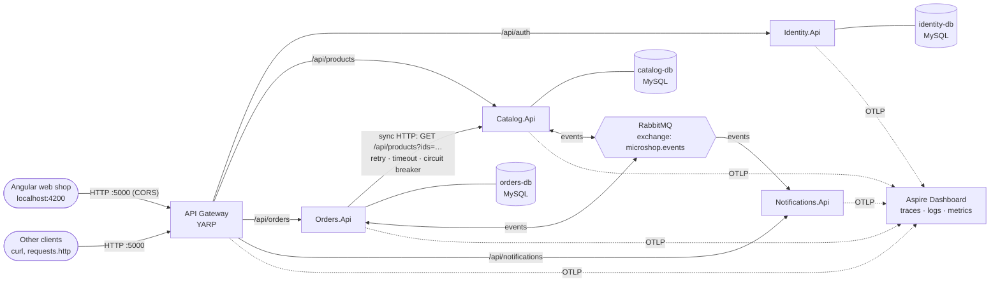

# MicroShop: a microservices learning project in .NET 10

A small online shop split into microservices, written so you can **read every line, run it with one
command, and watch a single request travel through the gateway, services, databases and message
broker**.

It's built with what a .NET developer already knows (ASP.NET Core controllers, EF Core, MySQL,
dependency injection) and adds only the pieces microservices need: an API gateway, service-to-service
HTTP with resilience, RabbitMQ events, the outbox pattern, JWT authentication with roles, health
checks and distributed tracing.

| | |
|---|---|
| Services | API Gateway, Identity, Catalog, Orders, Notifications, plus an Angular web shop |
| Stack | .NET 10, ASP.NET Core (controllers), EF Core 10 + MySQL 8.4, RabbitMQ 4.3, YARP, OpenTelemetry; Angular 22 + Angular Material |
| Runs with | `docker compose up --build` (backend) + `npm start` in `src/Web/microshop-web` (web app) |
| Tests | xUnit v3 unit tests + `scripts/smoke-test.ps1` end-to-end |

## Contents

1. [The system at a glance](#1-the-system-at-a-glance)
2. [Run it](#2-run-it)
3. [Follow one request end to end](#3-follow-one-request-end-to-end)
4. [Concepts, and where they live in the code](#4-concepts-and-where-they-live-in-the-code)
5. [Experiments: break it on purpose](#5-experiments-break-it-on-purpose)
6. [Project layout](#6-project-layout)
7. [How it was built, step by step (git history)](#7-how-it-was-built-step-by-step-git-history)
8. [Next exercises](#8-next-exercises)
9. [Technology choices](#9-technology-choices)
10. [Troubleshooting](#10-troubleshooting)

---

## 1. The system at a glance



| Service | Owns | Database | Talks to | Port (host) |
|---|---|---|---|---|
| **microshop-web** (Angular) | The shop and admin UI, the cart (in the browser) | none | the gateway only | 4200 (`npm start`) |
| **ApiGateway** | Routing, rate limiting, CORS | none | every service (HTTP) | 5000 |
| **Identity.Api** | Users, password hashes, roles; issues JWTs | `identity-db` | nobody (the others only check its tokens) | 5105 |
| **Catalog.Api** | Products, prices, stock | `catalog-db` | RabbitMQ | 5101 |
| **Orders.Api** | Orders and their lines | `orders-db` | Catalog (HTTP), RabbitMQ | 5102 |
| **Notifications.Api** | "Emails" sent to customers | none (in memory) | RabbitMQ | 5103 or 5104\* |

\* Notifications publishes the port *range* 5103-5104 so it can be scaled to two instances, and
Docker picks either one. `docker compose port notifications-api 8080` tells you which. The gateway
reaches it by its compose name, so this never affects the app.

Every service except Identity checks the caller's JWT itself; see
[4.12 Authentication and authorization](#412-authentication-and-authorization-jwt).

The events, all on one topic exchange:

| Routing key | Published by | Consumed by | Meaning |
|---|---|---|---|
| `order.placed` | Orders | Catalog, Notifications | A customer placed an order (status Pending) |
| `stock.reserved` | Catalog | Orders | Stock for every line is set aside |
| `stock.reservation-failed` | Catalog | Orders | Not enough stock; nothing was reserved |
| `order.confirmed` | Orders | Notifications | The order succeeded |
| `order.rejected` | Orders | Notifications | The order failed, with a reason |
| `order.cancelled` | Orders | Catalog, Notifications | The customer (or an admin) cancelled; Catalog gives back any stock it reserved |

---

## 2. Run it

### Prerequisites

- **Docker Desktop** (Windows: it installs WSL 2 for you; reboot when asked) or Podman Desktop.
  Give it at least 4 GB of RAM.
- **.NET 10 SDK**, only if you want to run tests or start services from Visual Studio.
- **Node.js** 22.22+, 24.15+ or 26+ (`winget install OpenJS.NodeJS.LTS`), for the Angular web app.

### Start everything

```bash
docker compose up --build
```

The first run downloads about 2 GB of images and builds five .NET images, so give it a few minutes.
After that it starts in seconds. Add `-d` to run it in the background.

| What | URL |
|---|---|
| API Gateway (the only URL a client needs) | http://localhost:5000/api/products |
| Aspire Dashboard: traces, structured logs, metrics | http://localhost:18888 |
| RabbitMQ management UI (`microshop` / `microshop_pw`) | http://localhost:15672 |
| Swagger UI per service (exposed for learning only) | http://localhost:5101/swagger, :5102/swagger, :5103/swagger (or :5104), :5105/swagger |
| MySQL (`catalog`/`catalog_pw`, `orders`/`orders_pw`, `identity`/`identity_pw`) | localhost:13306 (catalog), 13307 (orders), 13308 (identity) |

### Start the web shop

With the backend running, in a second terminal:

```bash
cd src/Web/microshop-web
npm install
npm start
```

`npm install` is needed the first time only. Then open **http://localhost:4200**: browse and filter
products, add them to the cart, log in, check out, and watch the order go from *Pending* to
*Confirmed* (or *Rejected*) live, with the emails it triggered and a link to its trace. Cancel it and
watch the stock come back. Log in as the admin to get **Admin**: product create, edit (price),
restock and delete. Details: [src/Web/microshop-web/README.md](src/Web/microshop-web/README.md).

### Log in: demo accounts and roles

The Identity service seeds two accounts the first time it starts:

| Account | Password | Role |
|---|---|---|
| `admin@microshop.local` | `Admin123!` | Admin |
| `customer@microshop.local` | `Customer123!` | Customer |

Anyone can register more (`POST /api/auth/register`, or **Create an account** in the web app); new
accounts are always *Customer*. These are demo passwords for a local learning project.

| Action | Anonymous | Customer | Admin |
|---|---|---|---|
| Browse and search products | yes | yes | yes |
| Fill a cart (it lives in the browser) | yes | yes | yes |
| Place an order | 401 | yes, as themselves | yes |
| See orders and their emails | 401 | their own | all |
| Cancel an order | 401 | their own | any |
| Create, edit (price), restock, delete products | 401 | 403 | yes |

Asking for another customer's order gives **404**, not 403, so the API doesn't reveal that it exists.

### Test it end to end

```bash
powershell -ExecutionPolicy Bypass -File scripts/smoke-test.ps1
```

It logs in as both demo accounts, places one order that gets **Confirmed** and one that gets
**Rejected**, waits for each to leave *Pending*, lists the notifications, cancels the confirmed order
and checks that its stock comes back, then checks that anonymous, customer and admin calls get 401,
403 and 200 where they should. It also prints a link to the confirmed order's trace. For manual
testing, open [`requests.http`](requests.http) in Visual Studio, Rider or VS Code (REST Client): run
the two login requests first, and the rest pick up their tokens.

### Unit tests

```bash
dotnet test
```

These need no Docker: domain rules, the stock-reservation handler (EF Core in-memory database,
including the duplicate-delivery case), and trace propagation through message headers.

### Stop

```bash
docker compose down
```

`docker compose down` keeps the databases. Add `-v` to wipe them, which also resets the seed data.

### Hybrid mode: debug one service in Visual Studio

Run the infrastructure (plus whatever services you're not debugging) in Docker, then press F5 on the
one you want to step through:

```bash
docker compose up -d rabbitmq catalog-db orders-db identity-db aspire-dashboard identity-api catalog-api
```

Then start `Orders.Api` from Visual Studio. Its `appsettings.json` already points at
`localhost:13307` (orders-db), `localhost:5672` (RabbitMQ) and `http://localhost:5101/` (Catalog),
and `launchSettings.json` sends telemetry to the dashboard on `localhost:4317`. Stop a service's
container before you F5 the same service, or the two will compete for the same port and queue.

---

## 3. Follow one request end to end

Here is everything that happens when a customer places an order.

```mermaid
sequenceDiagram
    autonumber
    participant C as Client
    participant G as Gateway
    participant O as Orders.Api
    participant ODB as orders-db
    participant CA as Catalog.Api
    participant CDB as catalog-db
    participant MQ as RabbitMQ
    participant N as Notifications.Api

    Note over C,G: earlier: POST /api/auth/login, Identity returns a JWT
    C->>G: POST /api/orders + Authorization: Bearer JWT
    G->>O: forward (+ traceparent header)
    O->>O: validate the JWT; the customer is its sub and email claims
    O->>CA: GET /api/products?ids=… (synchronous)
    CA->>CDB: SELECT products
    CA-->>O: 200 [name, price]
    O->>ODB: INSERT order (Pending) + INSERT outbox row, one transaction
    O-->>G: 202 Accepted {status: "Pending"}
    G-->>C: 202 + X-Trace-Id header

    Note over O,MQ: about a second later, in the background
    O->>MQ: publish order.placed (OutboxProcessor)
    MQ->>CA: order.placed (queue "catalog")
    MQ->>N: order.placed (queue "notifications")
    N->>N: "We received your order" email
    CA->>CDB: reserve stock + outbox(stock.reserved) + processed_messages, one transaction
    CA->>MQ: publish stock.reserved
    MQ->>O: stock.reserved (queue "orders")
    O->>ODB: order = Confirmed + outbox(order.confirmed)
    O->>MQ: publish order.confirmed
    MQ->>N: order.confirmed
    N->>N: "Your order is confirmed" email

    C->>G: GET /api/orders/{id}
    G->>O: forward
    O-->>C: {status: "Confirmed"}
```

### Where to look at each hop

1. **Send the request.** Use `requests.http` or the smoke test, and copy the `X-Trace-Id` response
   header.
2. **The trace.** Open http://localhost:18888, go to **Traces**, and filter by that ID. One trace
   holds around 20 spans from all four services: the gateway hop, the HTTP call from Orders to
   Catalog, the SQL statements, and every `… publish` / `… process` span through RabbitMQ. Look at
   the timeline: the HTTP part takes milliseconds; the event chain follows up to a second later.
3. **The logs.** In the dashboard's **Structured logs**, filter by the same trace ID to see every
   log line from every service for this one order. In a terminal:
   ```bash
   docker compose logs -f orders-api catalog-api notifications-api
   ```
4. **The broker.** In the RabbitMQ UI, go to **Exchanges → microshop.events → Bindings** to see
   which queue listens to which routing key. **Queues** shows `catalog`, `orders`, `notifications`
   and their `*.dead-letter` twins, with message rates and consumers.
5. **The databases.** The outbox and the inbox are ordinary tables:
   ```bash
   docker compose exec orders-db mysql -uorders -porders_pw orders -e "SELECT RoutingKey, OccurredOnUtc, ProcessedOnUtc FROM outbox_messages ORDER BY OccurredOnUtc DESC LIMIT 5;"
   docker compose exec catalog-db mysql -ucatalog -pcatalog_pw catalog -e "SELECT Name, AvailableStock, Version FROM products; SELECT * FROM processed_messages;"
   ```

---

## 4. Concepts, and where they live in the code

### 4.1 Service boundaries

A microservice owns **one business capability end to end**: its API, its logic and its data.
Catalog owns "what we sell and how many we have"; Orders owns "what customers bought". Split along
business capabilities (DDD calls them *bounded contexts*), not technical layers. A "Database
service" plus a "Validation service" is a distributed monolith.

A good boundary means most changes touch **one** service. If two services always change and deploy
together, they are one service in two pieces.

*In this repo:* `Product` lives only in Catalog. Orders has its own tiny `CatalogProduct` record with
just the fields it needs ([CatalogClient.cs](src/Services/Orders.Api/Clients/CatalogClient.cs)) and
no project reference to Catalog. The JSON is the contract, not a shared C# class.

### 4.2 Database per service

Each service has **its own database that nobody else touches**. Here that is literally a separate
MySQL container with separate credentials. Orders *cannot* query Catalog's tables.

Why: if two services share tables, neither can change its schema alone, and you're back to a
monolith with extra network calls.

What it costs:

- **No JOINs across services.** You call an API or listen to events instead.
- **Data is duplicated on purpose.** Each order line stores the product name and price *as they were
  at purchase time* ([Order.cs](src/Services/Orders.Api/Domain/Order.cs)). That's correct: if Catalog
  raises the price tomorrow, yesterday's order must not change.
- **No distributed transactions.** "Save the order" and "reserve the stock" happen in two
  databases, so they can't share one `BEGIN … COMMIT`. Sections 4.6 and 4.7 cover how we live with
  that.

*In this repo:* `catalog-db` and `orders-db` in [docker-compose.yml](docker-compose.yml);
`CatalogDbContext` and `OrdersDbContext`.

### 4.3 API gateway

The single entry point for clients. Clients know one address (`:5000`) instead of every service's
host and port, and services can move, split or scale behind it.

*In this repo* ([ApiGateway/Program.cs](src/ApiGateway/Program.cs),
[appsettings.json](src/ApiGateway/appsettings.json)), YARP handles:

- **Routing:** `/api/products/**` goes to Catalog, `/api/orders/**` to Orders, and so on.
- **Rate limiting:** 100 requests per 10 s per client IP, otherwise `429`.
- **Active health checks:** YARP probes each backend's `/health/ready` and stops sending traffic to
  one that fails.
- **Trace propagation:** the `traceparent` header is forwarded, so the trace continues downstream.

Other jobs gateways often take on: authentication (validate the JWT once at the edge; here the
gateway only forwards the `Authorization` header and each service validates it, see 4.12), TLS
termination, request aggregation (one client call fanning out to several services, the *Backend
for Frontend* pattern), and caching. Keep **business logic out** of the gateway, or it turns into
the new monolith.

### 4.4 Synchronous communication (HTTP)

Orders **calls** Catalog and **waits** for the answer, because it can't accept an order without
knowing the current price.

It's simple and familiar, and the caller gets an answer immediately. The cost is **temporal
coupling**: Orders can only take orders while Catalog is up. Chains multiply the risk. If each
service is up 99.9% of the time, a request through 5 of them succeeds only 99.5% of the time, and
latencies add up.

Rules of thumb:
- Make one call, not N. Orders fetches every line's product with a single `GET /api/products?ids=…&ids=…`.
- Always set a timeout. Then add retries and a circuit breaker (section 4.8).
- Use synchronous calls for **queries the caller can't proceed without**. Use events for "this
  happened, whoever cares can react".

*In this repo:* [CatalogClient.cs](src/Services/Orders.Api/Clients/CatalogClient.cs) (a typed
HttpClient) and its registration in [Orders.Api/Program.cs](src/Services/Orders.Api/Program.cs).
Inside Docker, `http://catalog-api:8080` is resolved by compose's DNS: the simplest form of
**service discovery**. Kubernetes Services do the same.

### 4.5 Asynchronous communication (events)

A service **publishes a fact** ("order placed") to RabbitMQ and moves on. It doesn't know or care who
listens. Each interested service has **its own queue**, bound to the routing keys it cares about.

```
                       routing key "order.placed"
Orders ──publish──▶ [microshop.events  (topic exchange)]
                         │ binding order.placed      │ binding order.placed
                         ▼                           ▼
                  [queue: catalog]           [queue: notifications]
                  Catalog.Api (×N)           Notifications.Api (×N)
```

- **Publish/subscribe (fan-out):** every *queue* gets its own copy, so Catalog and Notifications
  both receive `order.placed`. Adding Notifications in Step 5 needed **zero changes** to Orders.
- **Competing consumers:** all *instances* of one service share that service's queue, so each
  message is processed by exactly one instance. That's how you scale out (experiment 7).
- **Events vs commands:** an event is a past-tense fact (`order.placed`) that any number of
  services may react to. A command (`ReserveStock`) is a request to one specific service. This
  project uses events only.
- **Topic exchange:** routing keys are dot-separated words, so a queue can bind with wildcards,
  for example `order.*`.
- **Contracts:** the event records in [IntegrationEvents.cs](src/Shared/Contracts/IntegrationEvents.cs)
  are a public API. Adding a field is safe; renaming or removing one breaks consumers that haven't
  been redeployed yet.

*In this repo:* [RabbitMqTopology.cs](src/Shared/BuildingBlocks/Messaging/RabbitMqTopology.cs),
[RabbitMqConsumer.cs](src/Shared/BuildingBlocks/Messaging/RabbitMqConsumer.cs),
[MessagingExtensions.cs](src/Shared/BuildingBlocks/Messaging/MessagingExtensions.cs), and each
service's `Program.cs` (`builder.AddMessaging("catalog").Subscribe<…>(…)`).

### 4.6 Eventual consistency and sagas

`POST /api/orders` returns **202 Accepted** with status **Pending**, not *Confirmed*. For a moment,
Catalog may already have reserved the stock while Orders still says Pending. Shortly after, every
service agrees. That's **eventual consistency**: the price of having no distributed transaction,
paid in exchange for services that don't block each other.

A business process spread across services as a chain of local transactions plus events is a
**saga**. This one is **choreographed**: nobody is in charge, and each service reacts to the
previous event:

`order.placed` → Catalog reserves stock → `stock.reserved` → Orders confirms → `order.confirmed`

The alternative is **orchestration**: one component (for example a state machine in Orders) tells
each service what to do next. Choreography is simpler for short flows; orchestration is easier to
follow once there are many steps.

When a later step fails, or the customer changes their mind, a saga can't roll back. It
**compensates** with another action. Here: `POST /api/orders/{id}/cancel` marks the order
*Cancelled* and publishes `order.cancelled`; Catalog gives back the stock it reserved for that order.

`order.cancelled` → Catalog releases the reservation → Notifications sends "Your order was cancelled"

Two details make the compensation safe:

- **Catalog remembers what it reserved.** `OrderPlacedHandler` writes a `stock_reservations` row
  with its lines; `OrderCancelledHandler` releases exactly those, once (`ReleasedAtUtc`), and does
  nothing if the order was never reserved (it was rejected).
- **Cancel before confirm.** Orders publishes `order.placed` and `order.cancelled` from its outbox
  in order, and Catalog's queue is handled one message at a time, so Catalog reserves and then
  releases. When the late `stock.reserved` reaches Orders,
  `Confirm()` sees the order is already Cancelled and ignores it.

*In this repo:* [OrderPlacedHandler.cs](src/Services/Catalog.Api/Messaging/OrderPlacedHandler.cs),
[OrderCancelledHandler.cs](src/Services/Catalog.Api/Messaging/OrderCancelledHandler.cs),
[StockEventsHandler.cs](src/Services/Orders.Api/Messaging/StockEventsHandler.cs) and
`Cancel()` in [Order.cs](src/Services/Orders.Api/Domain/Order.cs).

### 4.7 Reliable messaging: outbox, idempotency, dead letters

**The dual-write problem.** "Save the order to MySQL" and "publish to RabbitMQ" are two systems.
Whichever you do first, a crash between the two leaves them out of step: an order nobody hears
about, or an event for an order that doesn't exist.

**The transactional outbox** fixes it. The event is written as a row in the service's **own
database, in the same transaction** as the business change. A background loop
([OutboxProcessor.cs](src/Shared/BuildingBlocks/Messaging/Outbox/OutboxProcessor.cs)) publishes
unsent rows and marks them sent. A side benefit: if RabbitMQ is down, orders are still accepted and
the events go out when it's back (experiment 4).

**At-least-once delivery.** If the publisher crashes after publishing but before marking the row,
the event is published again. If a consumer crashes after its transaction but before the ack, the
broker delivers again. Duplicates are normal, so **consumers must be idempotent**.

**The inbox (idempotent consumer).** Each handler records the message ID in `processed_messages`
in the same transaction as its work, and skips IDs it has already seen. The unit test
`The_same_message_delivered_twice_is_handled_once` shows it.

More details in the code:
- **Manual acks:** a message is acknowledged only after the handler's transaction commits.
- **Publisher confirms:** the outbox row is marked sent only once the broker has accepted the message.
- **Durability:** durable queues plus persistent messages survive a broker restart.
- **Retries, then a dead-letter queue:** 3 attempts, then the message moves to
  `<service>.dead-letter` instead of blocking the queue. A message that can't be parsed
  (a *poison message*) goes there straight away.
- **Optimistic concurrency:** two orders racing for the last keyboard. `Product.Version` makes one
  `SaveChanges` fail, and the retry re-reads fresh stock.

### 4.8 Resilience

In a distributed system something is always slow or down. Design for it:

| Pattern | What it does | Where |
|---|---|---|
| **Timeout** | Never wait forever: 2 s per attempt, 10 s total | `AddStandardResilienceHandler` in [Orders.Api/Program.cs](src/Services/Orders.Api/Program.cs) |
| **Retry with backoff + jitter** | Transient errors usually go away; jitter stops all clients retrying at the same moment | same |
| **Circuit breaker** | After repeated failures, stop calling for 15 s and fail fast, so the caller stays responsive and the callee gets room to recover | same |
| **Graceful degradation** | RabbitMQ down → `/health/ready` reports *Degraded* (not *Unhealthy*); the API keeps working and events queue in the outbox | [MessagingExtensions.cs](src/Shared/BuildingBlocks/Messaging/MessagingExtensions.cs) |
| **Retry on startup** | MySQL and RabbitMQ may start after the service; keep trying instead of crashing | [DatabaseInitializer.cs](src/Shared/BuildingBlocks/Persistence/DatabaseInitializer.cs), [RabbitMqConnection.cs](src/Shared/BuildingBlocks/Messaging/RabbitMqConnection.cs) |
| **Health checks** | `/health/live`: is the process alive (restart me?). `/health/ready`: can I do work (send me traffic?) | [ServiceDefaultsExtensions.cs](src/Shared/BuildingBlocks/ServiceDefaults/ServiceDefaultsExtensions.cs) |
| **Restart policy** | `restart: unless-stopped`: Docker restarts a crashed container | [docker-compose.yml](docker-compose.yml) |

Retry only idempotent operations: retrying a `GET` is safe; blindly retrying a `POST` that
charges a credit card is not. The chaos switch in Catalog lets you watch all of this happen
(experiment 3).

### 4.9 Observability: logs, metrics, traces

With one process you debug with a stack trace. With five you need to see a request's whole path.

- **Logs:** each line carries the `TraceId`, both in the console and in the dashboard.
- **Metrics:** request rates, latencies, GC and thread pool, from ASP.NET Core, HttpClient and the runtime.
- **Traces:** one tree of timed *spans* per request, across all services.

All three use **OpenTelemetry** and are exported over OTLP. The Aspire Dashboard displays them, but
you could swap it for Jaeger, Grafana or Azure Monitor without code changes.

**How a trace crosses process boundaries:** the W3C `traceparent` header
(`00-<trace-id>-<span-id>-01`). Over HTTP, .NET adds and reads it for you. Over RabbitMQ nothing
does it automatically, so this project does it by hand, which is the clearest way to see the idea:
1. the outbox row stores the creating span's `traceparent`;
2. the publisher starts a *Producer* span under it and writes it into the message headers;
3. the consumer starts a *Consumer* span from those headers.

*In this repo:* [MessagingTelemetry.cs](src/Shared/BuildingBlocks/Messaging/MessagingTelemetry.cs),
`ConfigureOpenTelemetry` in [ServiceDefaultsExtensions.cs](src/Shared/BuildingBlocks/ServiceDefaults/ServiceDefaultsExtensions.cs),
and the `X-Trace-Id` response header on every response.

### 4.10 Deployment

- **One image per service.** Each service has a multi-stage [Dockerfile](src/Services/Catalog.Api/Dockerfile):
  build with the SDK image, run on the small `aspnet` image as a non-root user.
- **Configuration from the environment.** The same image runs everywhere; only environment variables
  differ (`ConnectionStrings__CatalogDb`, `RabbitMq__HostName`, …). That's the *12-factor app* rule.
- **Independent deployability** is the point of all of the above. You can rebuild and restart one
  service (`docker compose up -d --build orders-api`) while the others keep running. Shared
  contracts make this harder, which is why they must stay backward compatible.
- **Compose is for local development.** In production the same images typically run on
  **Kubernetes**:

  | Here | Kubernetes |
  |---|---|
  | compose service | Deployment + Service |
  | gateway port 5000 | Ingress / Gateway API |
  | `/health/live`, `/health/ready` | `livenessProbe`, `readinessProbe` |
  | environment variables | ConfigMap and Secret |

  Each service also gets its own CI/CD pipeline.

### 4.11 What to share between services, and what not to

There are two shared projects, with different rules:

- **[Contracts](src/Shared/Contracts):** the event shapes. Services *must* agree on these. Keep them
  tiny, dependency-free and backward compatible. With separate repos you'd publish them as a
  versioned NuGet package or a schema.
- **[BuildingBlocks](src/Shared/BuildingBlocks):** infrastructure plumbing (service defaults,
  messaging, outbox, JWT validation). Sharing it is convenient but couples services' upgrade cycles. Many teams
  accept that for plumbing.
- **Never share domain logic or entities.** If Catalog and Orders shared a `Product` class, every
  change would need both teams and both deployments.

### 4.12 Authentication and authorization (JWT)

**Identity** is a service like the others, with its own database (`identity-db`, table `users`). It
hashes passwords with ASP.NET Core's `PasswordHasher` (PBKDF2) and, on login, issues a **JWT**
signed with HS256 that carries `sub` (the user id), `email` and `role`, valid for 2 hours.

The other services never call Identity. Each one **validates the token itself** (signature, issuer,
audience, lifetime) with one shared helper, `builder.AddJwtAuthentication()` in
[JwtAuthentication.cs](src/Shared/BuildingBlocks/Security/JwtAuthentication.cs). So logins fail
while Identity is down, but everyone who already has a token keeps working.

Authorization has two layers:

- **Roles on endpoints.** `[Authorize(Roles = Roles.Admin)]` on Catalog's create, update, restock
  and delete ([ProductsController.cs](src/Services/Catalog.Api/Controllers/ProductsController.cs));
  plain `[Authorize]` on Orders and Notifications. Product reads stay public.
- **Ownership in the query.** Orders filters by `CustomerId == the token's sub` unless the caller is
  an admin ([OrdersController.cs](src/Services/Orders.Api/Controllers/OrdersController.cs)), and
  Notifications filters by email the same way. The owner always comes from the token, never from the
  request body, so nobody can order "as" someone else.

The gateway only forwards the `Authorization` header. Checking in every service and not only at the
edge is *defense in depth*: a request that reaches a service some other way still needs a valid token.

Simplifications to know about: every service shares one symmetric key, so a service that can
*check* tokens could also *issue* them (production uses RS256/ES256 with public keys published as
JWKS; exercise 1); there are no refresh tokens (exercise 2); and the key sits in `appsettings.json`
(production reads it from a secret store).

---

## 5. Experiments: break it on purpose

Start the system with `docker compose up --build -d` first. Each experiment says what to expect.

**1. Watch eventual consistency.** Send *Place an order* in `requests.http`, then *GET* it at once:
`Pending`. A second later: `Confirmed`. In the dashboard trace, see the gap between the HTTP spans
and the `order.placed publish` span (the outbox poll interval).

**2. A rejected order.** Order 10 monitors (only 3 in stock): `202 Pending`, then `Rejected` with the
reason. Notifications sends "We couldn't complete your order". Stock is unchanged: all or nothing.

**3. Retries and the circuit breaker.** Make Catalog fail half of its product reads (PowerShell):
```powershell
$env:CATALOG_FAILURE_RATE = "0.5"; docker compose up -d catalog-api
```
Place several orders. Most still succeed. `docker compose logs catalog-api` shows the injected
`503`s, and the trace shows several attempts of the Orders → Catalog call. Listing products through
the gateway, though, fails about half the time: the gateway doesn't retry, only Orders does. Now
set the rate to `1` and place a few orders quickly. The breaker counts every failed *attempt*
(retries included), so it opens during the second order. From then on orders fail **instantly**
with `503 Catalog unavailable` for 15 s, and no calls reach Catalog. Try
`$env:CATALOG_EXTRA_LATENCY_MS = "3000"` to see the 2 s attempt timeout. Reset with
`Remove-Item Env:CATALOG_*; docker compose up -d catalog-api`.

**4. Broker outage: the outbox at work.**
```bash
docker compose stop rabbitmq
```
Place an order: still `202 Pending`. `http://localhost:5102/health/ready` says **Degraded**. The
`outbox_messages` row has `ProcessedOnUtc = NULL`. Then:
```bash
docker compose start rabbitmq
```
Within seconds the services reconnect, the outbox publishes, and the order becomes `Confirmed`.
Nothing was lost.

**5. A service is down.** `docker compose stop catalog-api`. Placing an order now fails with `503`
after the retries, because synchronous calls couple availability. `/api/products` through the
gateway fails too. `docker compose start catalog-api` brings it back.

**6. A poison message and the dead-letter queue.** In the RabbitMQ UI go to **Exchanges →
microshop.events → Publish message**:
- Routing key: `order.placed`
- Properties: `message_id` = any GUID
- Payload: `this is not json`

Catalog logs *"Cannot read … dead-lettering it"* and the message sits in the **catalog.dead-letter**
queue (**Get messages** to inspect it). The `notifications` queue got a copy too and dead-letters it
the same way.

**7. Scale out: competing consumers.**
```bash
docker compose up -d --scale notifications-api=2
```
RabbitMQ shows **2 consumers** on the `notifications` queue. Place a few orders and watch
`docker compose logs -f notifications-api`: the two instances share the work. Now call
`GET /api/notifications`. Some emails are missing: whichever instance answers only knows the ones
*it* sent, because in-memory state isn't shared. That's why stateful services keep their state in a
database.

**8. Rate limiting.**
```powershell
1..120 | % { try { (iwr http://localhost:5000/api/products -UseBasicParsing).StatusCode } catch { $_.Exception.Response.StatusCode.value__ } } | group
```
Roughly the first 100 return `200` and the rest `429`, until the 10-second window resets.

**9. Idempotency by hand.** Find an order's `stock.reserved` message ID in Catalog's
`outbox_messages`, then publish the same body with the same `message_id` and routing key
`stock.reserved` from the RabbitMQ UI. Orders logs *"already handled; skipping duplicate"* and
nothing changes.

---

## 6. Project layout

```
microservices-learning/
├── docker-compose.yml            # the whole system: 5 services, 3 MySQL, RabbitMQ, dashboard
├── Directory.Build.props         # net10.0, nullable, implicit usings for every project
├── Directory.Packages.props      # every NuGet version, in one place
├── requests.http                 # manual API calls
├── scripts/smoke-test.ps1        # end-to-end test through the gateway
├── src/
│   ├── ApiGateway/               # YARP routes, rate limiting, CORS
│   ├── Web/
│   │   └── microshop-web/        # Angular 22 + Angular Material shop and admin (its own README)
│   ├── Services/
│   │   ├── Identity.Api/         # Controllers/ Domain/ Data/ Security/ (TokenService) + Dockerfile
│   │   ├── Catalog.Api/          # Controllers/ Domain/ Data/ Messaging/ + Dockerfile
│   │   ├── Orders.Api/           # Controllers/ Domain/ Data/ Clients/ Messaging/ + Dockerfile
│   │   └── Notifications.Api/    # Controllers/ Messaging/ NotificationStore + Dockerfile
│   └── Shared/
│       ├── Contracts/            # integration events + routing keys
│       └── BuildingBlocks/
│           ├── ServiceDefaults/  # logging, health, OpenTelemetry, X-Trace-Id
│           ├── Persistence/      # create database with retry
│           ├── Security/         # JWT validation, roles, claims helpers
│           └── Messaging/        # RabbitMQ connection, consumer, topology, telemetry
│               └── Outbox/       # outbox + inbox tables, publisher loop
└── tests/
    ├── Catalog.Tests/            # Product rules, OrderPlacedHandler, OrderCancelledHandler (in-memory EF)
    ├── Orders.Tests/             # Order state machine, including cancel
    └── BuildingBlocks.Tests/     # trace context through message headers
```

---

## 7. How it was built, step by step (git history)

Each step is one commit, so you can replay the build-up and read each concept's diff on its own:

```bash
git log --oneline
git show <commit> --stat     # which files a step touched
git show <commit>            # the full diff, with the explanation in the commit message
```

| Step | Adds | Concepts |
|---|---|---|
| 1 | Catalog service + its MySQL, compose | service boundary, database per service, liveness vs readiness |
| 2 | Orders service, HTTP call to Catalog | sync communication, data snapshots, retry/timeout/circuit breaker |
| 3 | API gateway (YARP) | single entry point, routing, rate limiting, health-aware routing |
| 4 | RabbitMQ, events, outbox, inbox, dead letters | async messaging, eventual consistency, saga, idempotency |
| 5 | Notifications service | fan-out, loose coupling, stateless consumer |
| 6 | OpenTelemetry + Aspire Dashboard | traces, metrics, logs, trace context through a broker |
| 7 | Tests, smoke test, this README | verifying a distributed system |
| 8 | Catalog categories, search, edit/delete; CORS at the gateway | evolving an API without breaking a consumer (Orders), CORS |
| 9 | Angular web shop + admin | a front end that only knows the gateway; seeing eventual consistency in the UI |
| 10 | Identity service: register, log in, JWTs | a service that owns users, password hashing, stateless tokens |
| 11 | JWT validation and roles in every service | authentication vs authorization, roles, ownership checks, defense in depth |
| 12 | Cancel an order, release its stock | compensating action, idempotent consumer, events that arrive "too late" |
| 13 | Log in, roles and cancel in the web app | Bearer interceptor, route guards, showing only what a role may do |

To run an older step: `git checkout <commit>`, then `docker compose down -v` and
`docker compose up --build`. The `-v` matters: `EnsureCreated` never alters existing tables, so a
database created by an older step lacks newer columns. Real services use EF Core migrations for
exactly this reason (exercise 3). Return with `git checkout main`.

---

## 8. Next exercises

Roughly in order of difficulty. Each one teaches something new.

1. **Asymmetric keys (RS256 + JWKS).** Keep the private key in Identity only, publish the public
   key at `/.well-known/jwks.json`, and point the services at it (`Authority` or `MetadataAddress`).
   Now a leaked service config can check tokens but no longer mint them.
2. **Refresh tokens and revocation.** Short access tokens (5 minutes) plus a refresh token stored in
   `identity-db` that can be revoked. What does "log out" mean for an access token already issued?
3. **EF Core migrations per service** instead of `EnsureCreated`, applied at startup or in a
   separate deploy step.
4. **Delayed retries for messages.** Replace the 3 immediate attempts with a retry queue that has a
   TTL and dead-letters back to the main queue (1 s, 10 s, 60 s).
5. **Remove the synchronous call.** Have Catalog publish `product.price-changed` and let Orders keep
   a local read model of prices (*event-carried state transfer*). Orders then works even when
   Catalog is down. What do you lose?
6. **An orchestrated saga.** Rebuild the order flow as a state machine in Orders that sends
   commands, and compare it with the choreography.
7. **Scale the outbox.** With 2 instances of Orders, both loops publish the same rows. Fix it with
   `SELECT … FOR UPDATE SKIP LOCKED`, or compare with MassTransit, Wolverine or NServiceBus, which
   ship an outbox.
8. **Custom metrics.** Add an `orders.placed` counter and an `order.time_to_confirm` histogram
   (`System.Diagnostics.Metrics`) and graph them in the dashboard.
9. **gRPC** between Orders and Catalog instead of REST.
10. **Contract tests.** Use Pact or schema checks so a change to an event or API that breaks a
    consumer fails CI.
11. **Kubernetes.** Run it on kind or minikube with Deployments, Services, an Ingress, and
    liveness/readiness probes on `/health/*`. Or try **.NET Aspire** as the local orchestrator and
    compare it with compose.
12. **CI.** Add a GitHub Actions workflow that builds every image and runs the tests and the smoke
    test on each push.
13. **Authorization at the gateway too.** Add YARP authorization policies per route (for example
    product writes need the Admin role), on top of the services' own checks, and compare where each
    check belongs.

---

## 9. Technology choices

| Choice | Why | Alternatives |
|---|---|---|
| ASP.NET Core **controllers** | Familiar, so the only new things are the microservice ideas | Minimal APIs (less ceremony; used by Microsoft's eShop sample) |
| **Angular 22 + Angular Material** for the web app | Standalone components, signals and zoneless change detection are today's Angular defaults; Material gives accessible tables, forms and dialogs | React, Blazor WebAssembly, Bootstrap or plain CSS |
| **CORS at the gateway** | The browser only ever talks to the gateway, so that's the only place that needs it | A dev-server proxy (`proxy.conf.json`), or serving the web app from the same origin as the API |
| **YARP** gateway | Microsoft's reverse proxy; config-driven, fast, plain ASP.NET Core middleware | Ocelot, Envoy, NGINX, Azure API Management |
| **RabbitMQ.Client** directly | Every exchange, queue, ack and header is visible in our code | MassTransit (v9 is commercially licensed), Wolverine, NServiceBus, Azure Service Bus, Kafka |
| **MySQL** via Oracle's `MySql.EntityFrameworkCore` | Supports EF Core 10 | Pomelo (the popular provider, but on EF Core 9 at the time of writing), PostgreSQL, SQL Server |
| **Aspire Dashboard** | One container shows traces, logs and metrics together | Jaeger, Zipkin, Seq, Prometheus + Grafana, Azure Monitor |
| **Outbox by hand** | You see exactly how it works | the outbox built into MassTransit, Wolverine or NServiceBus |
| **Our own Identity service issuing JWTs** | Every piece is visible: hashing, claims, signing, validation | Duende IdentityServer, OpenIddict, Keycloak, Microsoft Entra ID, Auth0 |

---

## 10. Troubleshooting

| Symptom | Fix |
|---|---|
| `docker: command not found` | Install Docker Desktop and reboot. |
| `port is already allocated` | Something else uses the port (for example 5000 or 5672). Change the left-hand side in `ports:` in `docker-compose.yml`. |
| Errors about unknown columns or tables after switching steps | `docker compose down -v`, then up again. `EnsureCreated` doesn't migrate. |
| RabbitMQ `PRECONDITION_FAILED - inequivalent arg` | A queue exists with older settings. `docker compose down`, then up. The broker has no volume, so queues are recreated. |
| Orders stay `Pending` | Is RabbitMQ healthy (`docker compose ps`)? Check `docker compose logs catalog-api orders-api` for handler errors, and look at the `*.dead-letter` queues. |
| `401 Unauthorized` | No token, or it expired (2 hours). Log in again (`POST /api/auth/login`); the web app sends you to its login page by itself. |
| `403 Forbidden` | Logged in, but not as an admin. Product changes need `admin@microshop.local`. |
| http://localhost:5103 doesn't answer | Notifications may have got 5104 instead; see the note under the services table. |
| Nothing in the Aspire Dashboard | It only shows data received since it started. Send a request, then refresh. |
| `An Application Control policy has blocked this file` from `dotnet run`/`dotnet test` | Windows **Smart App Control** is blocking a freshly built, unsigned file (seen on this machine with `Catalog.Tests.dll`). Docker is unaffected, because the containers are Linux. Options: run the tests in Docker or CI, or turn Smart App Control off under *Windows Security → App & browser control* (on some Windows versions it can't be switched back on without a reset, so check first). The repo already sets `UseAppHost=false` to avoid blocked `.exe` launchers. |
